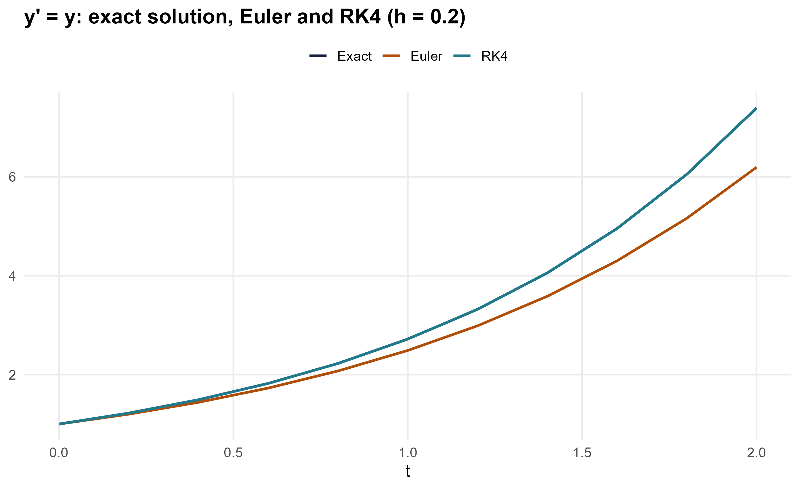
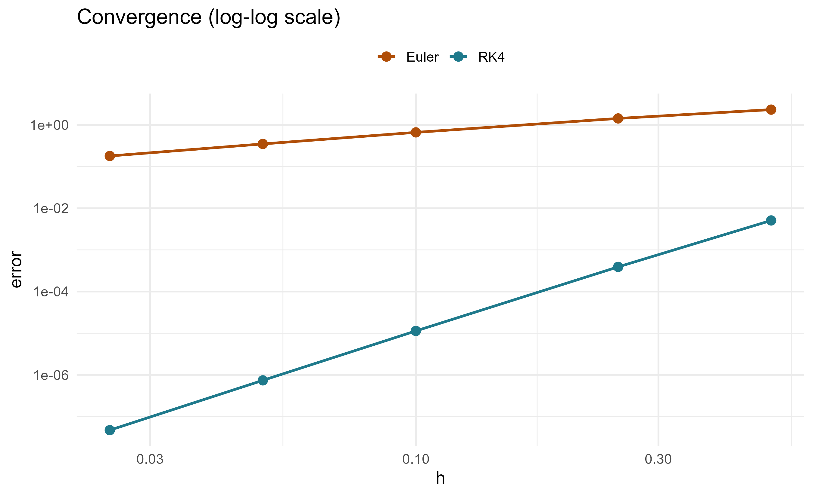
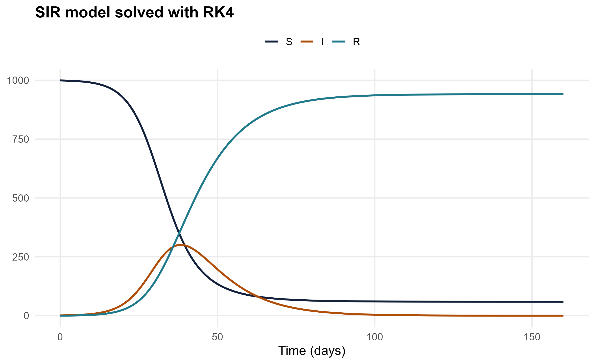

# rungekutta

Solving ordinary differential equations (ODEs) with the fourth-order
Runge-Kutta method (RK4), in R. The package also provides Euler's method for
comparison, a ready-to-use SIR epidemic model, and plotting functions based on
ggplot2.

## Installation

```r
# install.packages("pak")
pak::pak("CKEN4840/rungekutta")
```

## A simple example

We solve y' = y with y(0) = 1, whose exact solution is exp(t).

```r
library(rungekutta)

f   <- function(t, y) y
sol <- rk4(f, y0 = 1, t0 = 0, tf = 2, h = 0.1)

tail(sol, 1)   # computed value at t = 2
exp(2)         # exact value
```

## Comparing the methods

```r
e <- euler(f, y0 = 1, t0 = 0, tf = 2, h = 0.2)
r <- rk4(f,   y0 = 1, t0 = 0, tf = 2, h = 0.2)
exact <- data.frame(t = e$t, y1 = exp(e$t))

comparer_solutions(Exact = exact, Euler = e, RK4 = r)
```





## An epidemic: the SIR model

```r
sir <- rk4(modele_sir(beta = 0.3, gamma = 0.1, N = 1000),
           y0 = c(S = 999, I = 1, R = 0), t0 = 0, tf = 160, h = 0.5)
plot(sir)
```



## Main functions

| Function | Purpose |
|---|---|
| `rk4()` | Fourth-order Runge-Kutta method |
| `euler()` | Euler's method (order 1) |
| `modele_sir()` | SIR epidemic model |
| `plot()` | Plots a solution |
| `comparer_solutions()` | Overlays several solutions |

## License

MIT
