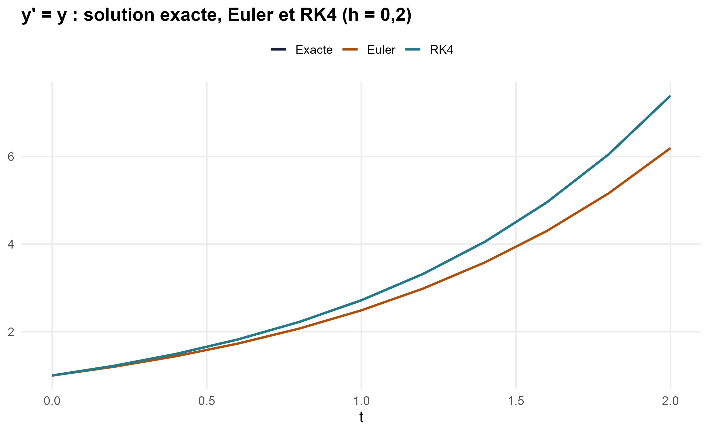
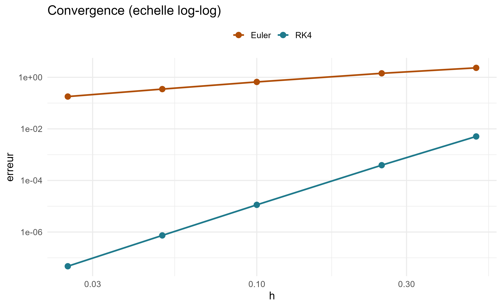
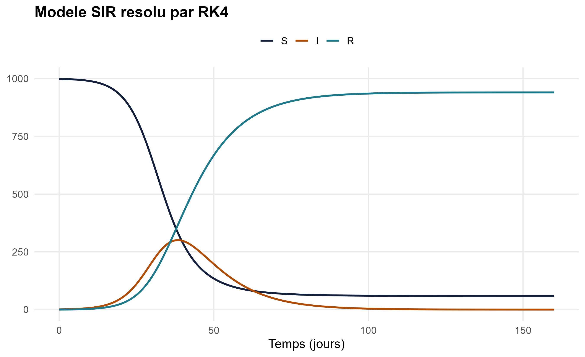
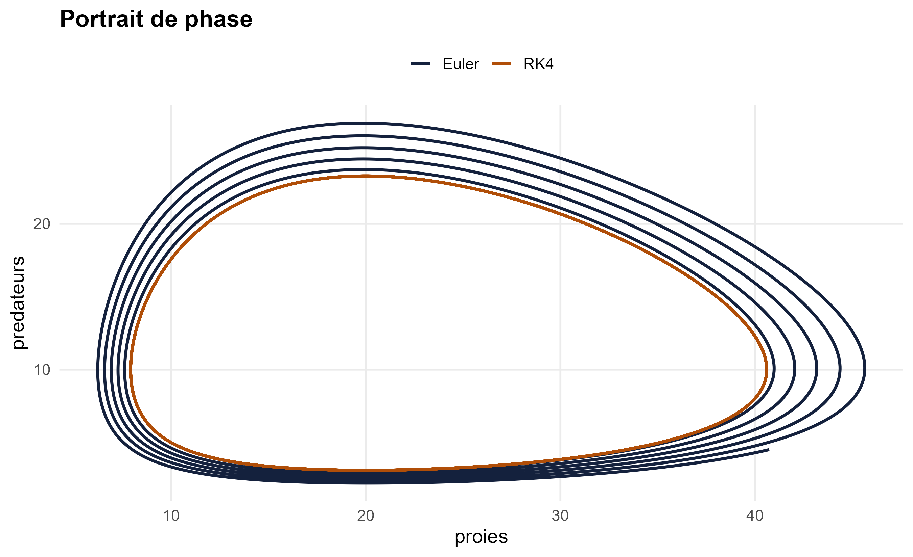

# rungekutta

Résolution d'équations différentielles ordinaires par la méthode de
Runge-Kutta d'ordre 4, en R. Le package fournit aussi la méthode d'Euler pour
comparer, deux modèles prêts à l'emploi (SIR et Lotka-Volterra) et des fonctions
de représentation graphique avec ggplot2.

## Installation

```r
# install.packages("pak")
pak::pak("CKEN4840/rungekutta")
```

## Exemple simple

On résout y' = y avec y(0) = 1, dont la solution exacte est exp(t).

```r
library(rungekutta)

f   <- function(t, y) y
sol <- rk4(f, y0 = 1, t0 = 0, tf = 2, h = 0.1)

tail(sol, 1)   # valeur calculée en t = 2
exp(2)         # valeur exacte
```

## Comparer les méthodes

```r
e <- euler(f, y0 = 1, t0 = 0, tf = 2, h = 0.2)
r <- rk4(f,   y0 = 1, t0 = 0, tf = 2, h = 0.2)
exacte <- data.frame(t = e$t, y1 = exp(e$t))

comparer_solutions(Exacte = exacte, Euler = e, RK4 = r)
```





## Une épidémie : le modèle SIR

```r
sir <- rk4(modele_sir(beta = 0.3, gamma = 0.1, N = 1000),
           y0 = c(S = 999, I = 1, R = 0), t0 = 0, tf = 160, h = 0.5)
plot(sir)
```



## Proies et prédateurs : Lotka-Volterra

```r
f_lv <- modele_lotka_volterra(alpha = 1, beta = 0.1, delta = 0.075, gamma = 1.5)
y0   <- c(proies = 10, predateurs = 5)

lv_e <- euler(f_lv, y0, 0, 30, 0.01)
lv_r <- rk4(f_lv,   y0, 0, 30, 0.01)

portrait_de_phase(Euler = lv_e, RK4 = lv_r, x = "proies", y = "predateurs")
```



Euler s'éloigne de l'orbite fermée, alors que RK4 y reste.

## Fonctions principales

| Fonction | Rôle |
|---|---|
| `rk4()` | Méthode de Runge-Kutta d'ordre 4 |
| `euler()` | Méthode d'Euler (ordre 1) |
| `modele_sir()` | Modèle épidémique SIR |
| `modele_lotka_volterra()` | Modèle proies-prédateurs |
| `invariant_lotka_volterra()` | Quantité conservée, pour mesurer l'erreur |
| `plot()` | Trace une solution |
| `comparer_solutions()` | Superpose plusieurs solutions |
| `portrait_de_phase()` | Trace une composante en fonction d'une autre |

## Licence

MIT
